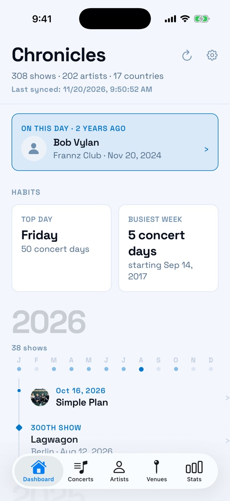
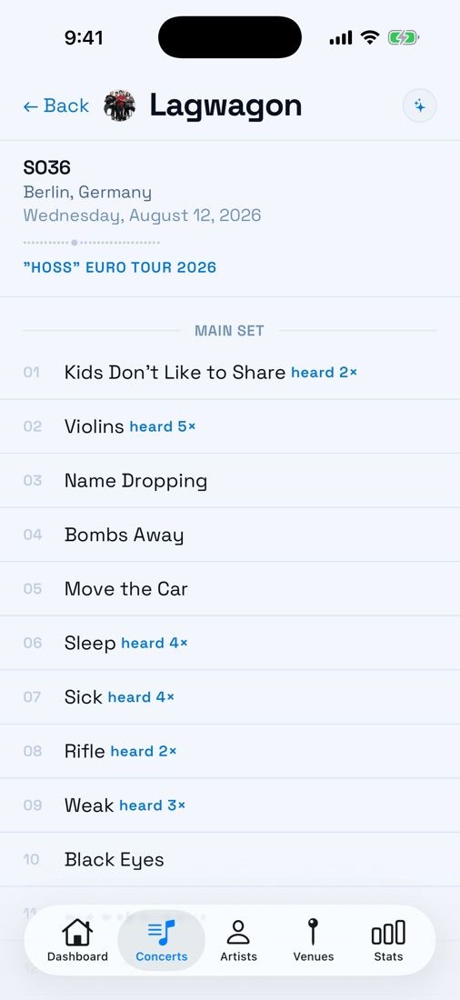
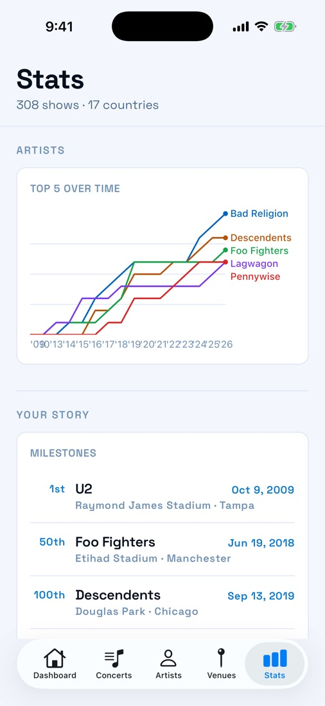
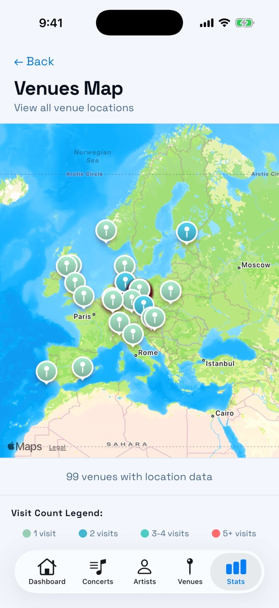

# Chronicles

An iOS and Android app for your concert history. It syncs the concerts you've marked as attended on [setlist.fm](https://www.setlist.fm/) into a local SQLite database and lets you browse them by concert, artist and venue, with stats and maps on top.

<table>
  <tr>
    <td></td>
    <td></td>
    <td></td>
    <td></td>
  </tr>
  <tr>
    <td align="center">Dashboard</td>
    <td align="center">Setlist</td>
    <td align="center">Stats</td>
    <td align="center">Venues map</td>
  </tr>
</table>

## Features

- Concert timeline with full setlists, covers and guest appearances
- How often you heard each song live, and an "on this day" card for past shows
- Artists and venues, venues broken down by continent, country and city
- Stats: shows per year, top artists over time, top day by era, milestones and a world map
- Incremental sync: re-syncing only fetches what's new
- Light and dark mode, phone and tablet layouts
- Accessible: every control is at least 44 pt, text uses Apple's text styles, and VoiceOver reads each card, chart and row as one item

## Setup

You need Node 24 (see `.nvmrc`), Yarn, and Xcode or Android Studio.

Create a `.env` file at the repo root with your setlist.fm API key (request one from your [setlist.fm API settings](https://www.setlist.fm/settings/api)):

```bash
SETLISTFM_API_KEY=your_api_key_here
```

`.env` is gitignored, never commit it.

```bash
yarn install
yarn ios        # or: yarn android
```

On first launch, enter your setlist.fm username and the app syncs your concerts.

## Tests

```bash
yarn test       # unit + headless integration tests
yarn lint       # ESLint, fails on any warning
yarn test:e2e   # Maestro flows on a booted simulator with the app installed
```

CI runs lint, tests and the typecheck on every PR. Maestro runs locally and on demand on CI (`gh workflow run e2e.yml --ref <branch>`), see [CLAUDE.md](CLAUDE.md) for when it's required.

## Tech stack

- Expo (SDK 58) with Expo Router and native tabs
- TypeScript
- SQLite via `expo-sqlite`, all data stays on the device
- `react-i18next` for copy
- Jest with `expo-router/testing-library`, Maestro for end-to-end

Architecture notes live in [CLAUDE.md](CLAUDE.md).
